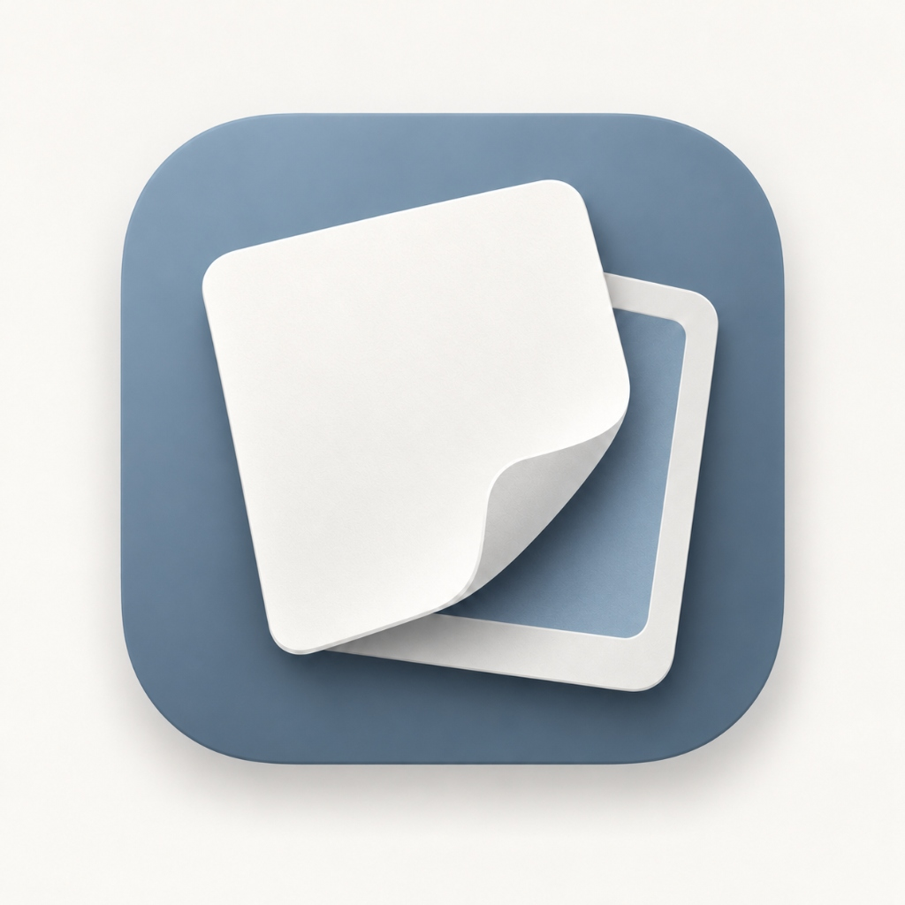

<p align="center">
  
</p>

<h1 align="center">LETGO</h1>

<p align="center">
  <b>为素材进行快速分类整理，减轻选片负担。</b><br>
  A lightweight desktop tool designed to eliminate the friction of photo and video culling.
</p>

---

## 痛点与初衷

拍摄归来后，成百上千张未经筛选的原始素材往往会变成一种心理压力：

- **选片内耗**：连拍相似张反复对比，犹豫不决，耗费大量时间与精力；
- **存储臃肿**：失焦与废片舍不得删、没空删，长年挤占宝贵的本地硬盘；
- **整理繁琐**：手动创建文件夹、拖拽分类流程冗长，导致素材堆积积灰。

LETGO 的目标只有一个：**把原本繁重的挑片过程，变成轻快、无负担的肌肉记忆。**

## 核心解法

### 1. 单键决断，流程无阻
无需鼠标反复点击确认菜单。左手键盘三键流：
- `F` 保留心动好片（Keep）
- `D` 跳过待定项（Skip）
- `X` 标记废片丢入回收站（Reject）

支持随时 `Ctrl+Z` 撤销，让决策毫无心理包袱。

### 2. 毫秒级查焦与细节确认
滚轮直接以当前鼠标指针为中心平滑放大，无需先挪动画面再找主体。0.1 秒确认对焦点锐度与眼神光，行云流水切到下一张。

### 3. 一键结构化规整
初筛完成后，软件自动按照 **旅程 / 地点 / 标签** 建立清晰的本地目录结构，支持安全的无损复制或校验移动。被剔除的废片移入系统回收站，原片不冒任何丢失风险。

### 4. 影调与色温直觉辅助
集成实时色彩与影调罗盘，自动感知冷暖倾向（如冷调 60% vs 暖调 40%）、明暗基调与主色覆盖率，帮助创作者在挑选时一眼掌握成组素材的影调一致性。

---

## 快捷键

| 按键 | 动作 |
| :--- | :--- |
| `F` | **收录** 当前素材 |
| `D` | **跳过** 当前素材 |
| `X` | **标记删除** 当前素材 |
| `Ctrl` / `Cmd` + `Z` | **撤销** 上一步操作 |
| 鼠标滚轮 | 以光标所在位置为中心缩放检查对焦 |
| `←` / `→` | 切换上一张 / 下一张 |
| `I` | 展开 / 收起检查器与影调罗盘 |
| `Q` `W` `E` `R` `T` `Y` | 快速添加对应标签 |
| `Shift` + `Q` | 新建自定义标签 |
| `Space` | 播放 / 暂停视频 |
| `J` / `L` | 视频快退 / 快进 5 秒 |

---

## 运行与构建

### 依赖
- Node.js >= 20.0.0
- npm >= 10.0.0

### 本地启动
```sh
git clone https://github.com/Akikkan/LETGO.git
cd LETGO
npm install
npm start
```

### 独立打包
```sh
npm run package:win        # Windows x64
npm run package:mac        # macOS Apple Silicon
npm run package:mac:intel  # macOS Intel
```

---

## 许可证

[MIT](LICENSE)
